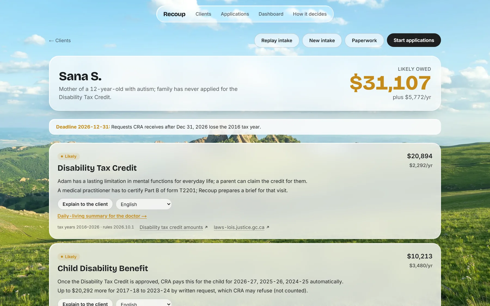
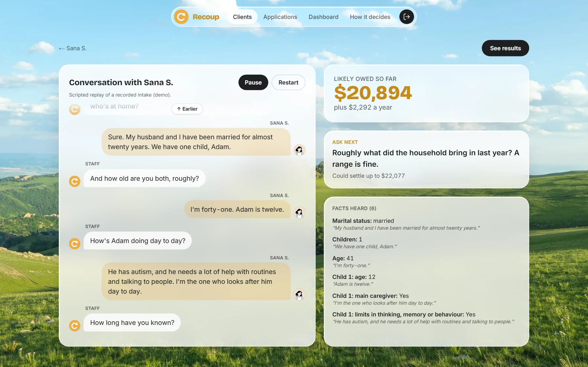
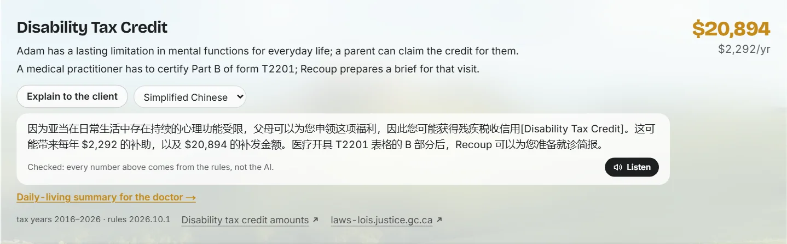
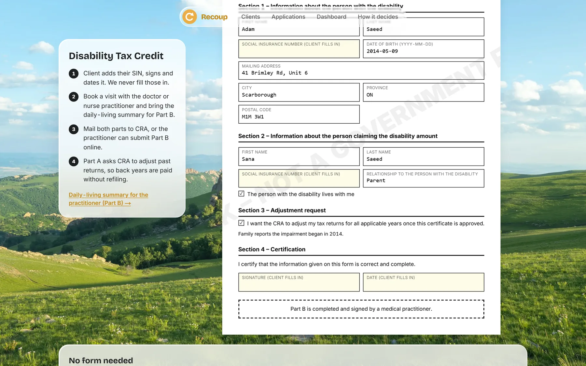
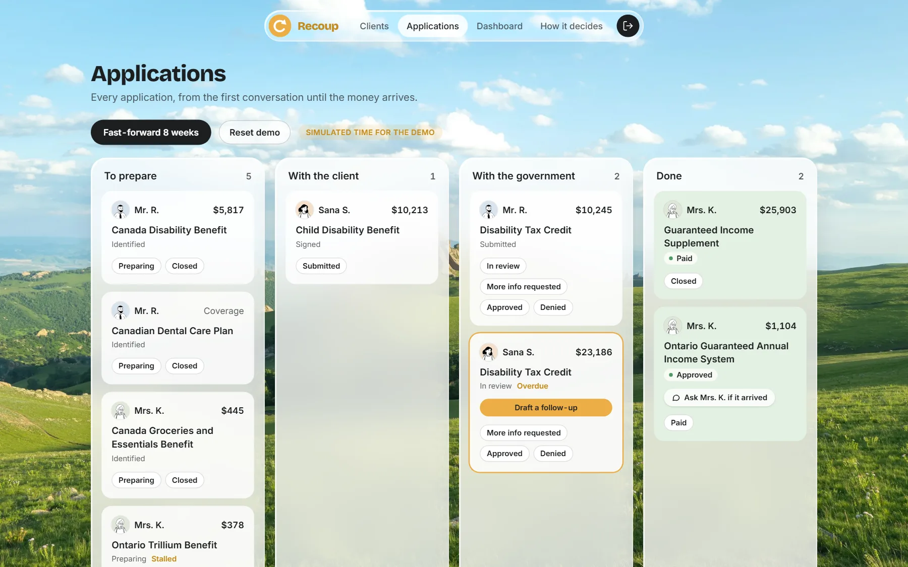
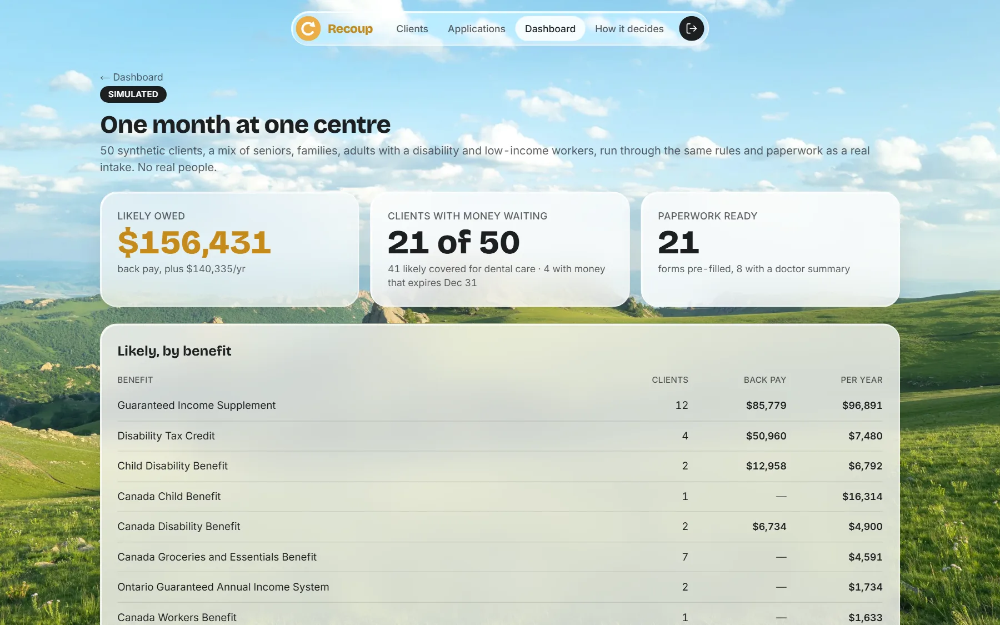
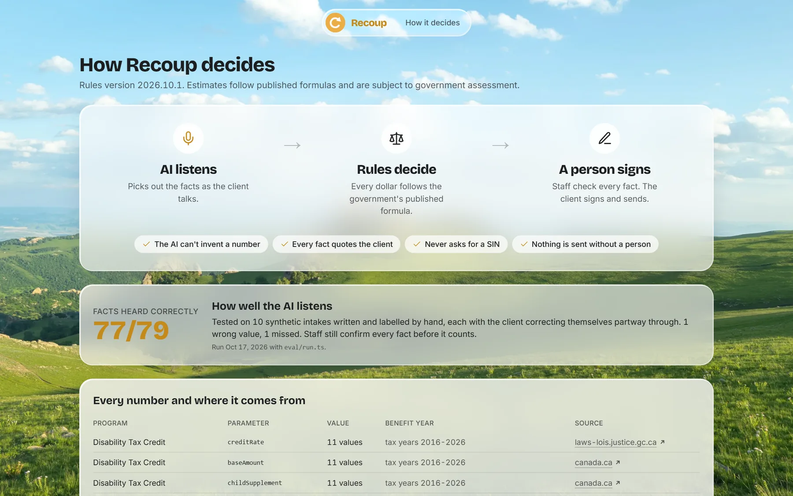

<div align="center">
  

  # Recoup

  **Get people the money they're already owed.**

  [](https://nextjs.org/)
  [](https://react.dev/)
  [](https://www.typescriptlang.org/)
  [](https://tailwindcss.com/)
  [](https://ai.google.dev/)

  Built at Hack the Valley 11 · [Quick Start](#-quick-start) · [How it decides](#-trust)
</div>

---

## 🧭 Overview

Recoup is a tool for **community centres and free tax clinics** that helps staff find the government benefits a client
is likely owed, prepare the paperwork, and follow each application until the money actually arrives.

> *Sana's son Adam has autism. In one intake conversation, Recoup found about **$31,107** in Disability Tax Credit and
> Child Disability Benefit back pay the family never claimed, filled in Part A of the T2201, and wrote a one-page
> summary for Adam's doctor.* (Demo persona; synthetic data.)

### Why Recoup?

- **The money exists; the paperwork is where people fall off.** Only about 1 in 4 people likely eligible for the
  Disability Tax Credit complete an application, and only 17% of people who start it online get the doctor's part done
  ([CRA Disability Advisory Committee, 2024](https://www.canada.ca/en/revenue-agency/corporate/about-canada-revenue-agency-cra/disability-advisory-committee/2024-full-report.html)).
- **Rules decide, AI listens.** Every eligibility status and every dollar comes from hand-written rules that follow
  published CRA, Service Canada and Ontario formulas, each with its benefit year and source. The AI never decides.
- **Finished paperwork, not just a screener.** Pre-filled mock forms the client checks and signs, plus a doctor summary
  for the step where most applications stall.
- **Follow-through.** Every application is tracked until it's paid, with follow-ups drafted when a decision runs late.
- **Free for clients.** No cut of anyone's refund. Recoup never submits anything to the government and never stores a SIN.

<div align="center">
  
  <p><em>Results: what the client is likely owed, the rule behind every dollar, and the source</em></p>
</div>

---

## 🚀 Features

### 🎙️ Intake

| Feature | Description |
|---|---|
| **Consent first** | The client chooses recording or typed notes before anything is heard. Consent is written to the audit log. |
| **Live fact extraction** | Gemini pulls facts from the conversation as it happens. Each fact carries the exact words it came from ("no quote, no fact"); staff confirm or remove each one. |
| **Ask next** | The most valuable missing question is always on screen, ranked by how much money it could settle. |
| **Document reader** | Snap a notice of assessment: Gemini reads lines 10100, 15000 and 23600 and the tax year, checked against the printed text. |

<div align="center">
  
  <p><em>An intake: facts appear with the words they came from, and the next most valuable question is always on screen</em></p>
</div>

### ⚖️ Rules engine

| Feature | Description |
|---|---|
| **11 programs calculated** | DTC (with back years), Child Disability Benefit, Canada Disability Benefit, GIS (single and couple), OAS, CCB, Canada Groceries and Essentials Benefit, Canada Workers Benefit, Ontario GAINS, Ontario Trillium Benefit, Canadian Dental Care Plan |
| **9 referral flags** | ODSP, Ontario Works, CPP Disability, RDSP and others the engine doesn't calculate yet |
| **Sourced parameters** | Every number is stored as `{value, benefitYear, sourceUrl}` and shown on the "How it decides" page |
| **Honest uncertainty** | Unconfirmed facts count as unknown, so a result stays "possible" until staff confirm them. Deadlines (like DTC years that expire on Dec 31) are flagged. |
| **Explain to the client** | One click rewrites the reasons in plain words in Punjabi, Tamil, Arabic, Simplified Chinese, Urdu, Tagalog, French, Spanish or English. If the AI's text contains any number the rules didn't produce, the rule's own wording is shown instead. |

<div align="center">
  
  <p><em>A Disability Tax Credit result explained in Punjabi; every number checked against the rules</em></p>
</div>

### 📝 Paperwork

| Feature | Description |
|---|---|
| **Pre-filled mock forms** | T2201 Part A, RC66 (Canada Child Benefits) and ISP-3025 (GIS), filled from confirmed facts. SIN, bank details and signatures are always left for the client. |
| **Doctor summary** | A printable daily-living summary organised by the T2201 Part B categories, next to the test CRA applies, quoting what the family said |
| **Client take-home** | A plain-language printout: what you may get and what happens next, with a large-print option |

<div align="center">
  
  <p><em>T2201 Part A, pre-filled; SIN and signature stay with the client</em></p>
</div>

### 📬 Follow-through

| Feature | Description |
|---|---|
| **Application tracker** | Every application from "identified" to "paid", with overdue and stalled flags |
| **Follow-up drafts** | When a decision runs late, Gemini drafts a status inquiry and a text to the client; staff edit and approve before anything "goes out" |
| **Dashboard** | What was found, what was sent, and what actually arrived, by benefit |
| **A simulated month** | 50 synthetic clients run through the same rules and paperwork, to show what one centre could recover |

<div align="center">
  
  <p><em>Every application from the first conversation until the money arrives (demo clock)</em></p>
</div>

<div align="center">
  
  <p><em>One month at one centre, simulated: 50 synthetic clients</em></p>
</div>

### 🔍 Trust

- **77 of 79 facts** heard correctly on 10 hand-labelled intakes, each with the client correcting themselves partway through (`eval/run.ts`)
- AI explanations are checked: if one mentions a dollar figure the rules didn't produce, the rule's own wording is shown instead
- Audit log of every save, stage change, consent and approval
- Demo data is synthetic, and simulated time, texts and sends are labelled as such

<div align="center">
  
  <p><em>Every parameter with its benefit year and source, the extraction score, and the audit log</em></p>
</div>

---

## 🛠️ Tech Stack

**Frontend**


**AI**


**Backend**


The Liquid Glass UI is hand-built: an SVG displacement map computed from a squircle dome and Snell's law, with a
frosted fallback for browsers without SVG backdrop filters and for reduced-transparency settings.

---

## ⚡ Quick Start

```bash
git clone https://github.com/JulianCruzet/recoup.git
cd recoup
npm install
```

Create `.env.local`:

```bash
GEMINI_API_KEY=your-key   # from https://aistudio.google.com/apikey
```

```bash
npm run dev      # http://localhost:3000
npm test         # 140+ tests: rules, forms, tracker, parsers, guard
npx tsx --conditions=react-server eval/run.ts   # score fact extraction on eval/transcripts
```

The database is an embedded Postgres (PGlite) in `.data/`, created and seeded with three demo clients on first run.
Delete `.data/` to start fresh. Without a Gemini key, the scripted intake replay, results, paperwork, tracker and
dashboard all still work.

To deploy (for example on Vercel), set `GEMINI_API_KEY` and `PGLITE_DIR=/tmp/pglite`; the demo data is re-seeded
whenever the instance starts fresh.

---

## 📁 Project Structure

```
app/
  (app)/clients/[id]/        results, live intake, replay, paperwork, doctor brief
  (app)/tracker/             applications board + simulated fast-forward
  (app)/dashboard/           totals and the simulated month
  (app)/trust/               how it decides: guardrails, every parameter, audit log
  api/                       extract, documents, facts, consent, follow-up
components/
  forms/                     mock T2201 Part A, RC66, ISP-3025
  glass/                     Liquid Glass (SVG displacement)
lib/
  rules/                     the rules engine, one file per program, params/*.json with sources
  ai/                        Gemini client, fact extraction, document reader, follow-ups
  packages/                  form filling and the doctor brief
  tracker/  simulate/        application stages and the simulated month
eval/                        labelled transcripts and the extraction scorer
seed/                        demo personas and 50 synthetic clients
```

---

## ⚠️ Disclaimer

Recoup gives information, not legal or tax advice. Estimates follow published formulas and are subject to government
assessment. Forms are mock forms for practice and review. All people in the demo are synthetic. Not affiliated with
the Canada Revenue Agency, Service Canada or the Government of Ontario.

## 👥 Team

Built at Hack the Valley 11 by [Julian Cruzet](https://github.com/JulianCruzet) and [Ali](https://github.com/shambo2).

Background photo by [Jimmy Liu](https://unsplash.com/photos/green-hills-and-a-beautiful-blue-sky-Kn1eMkcZ1BU) on Unsplash.
